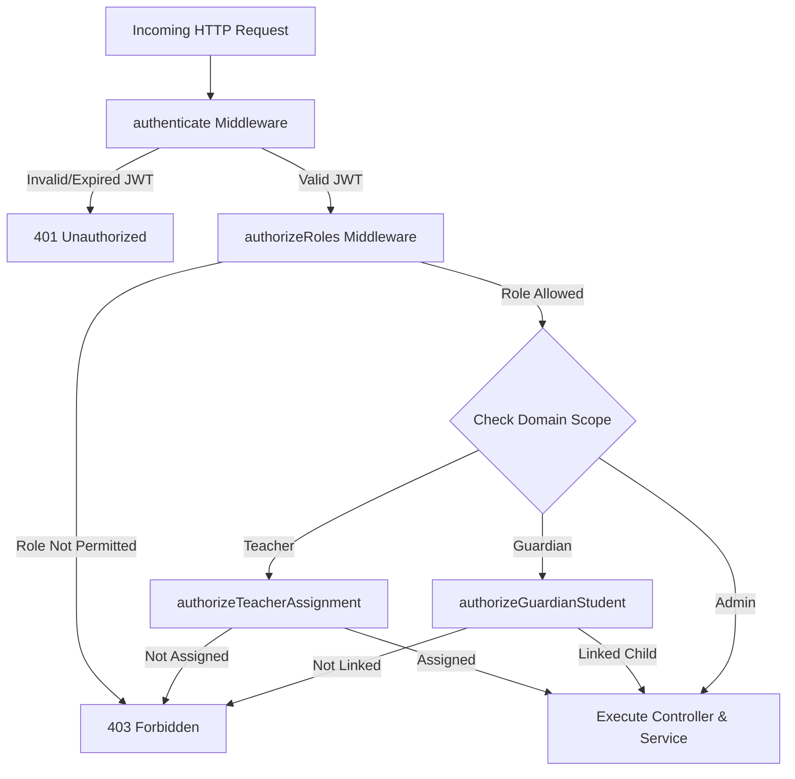
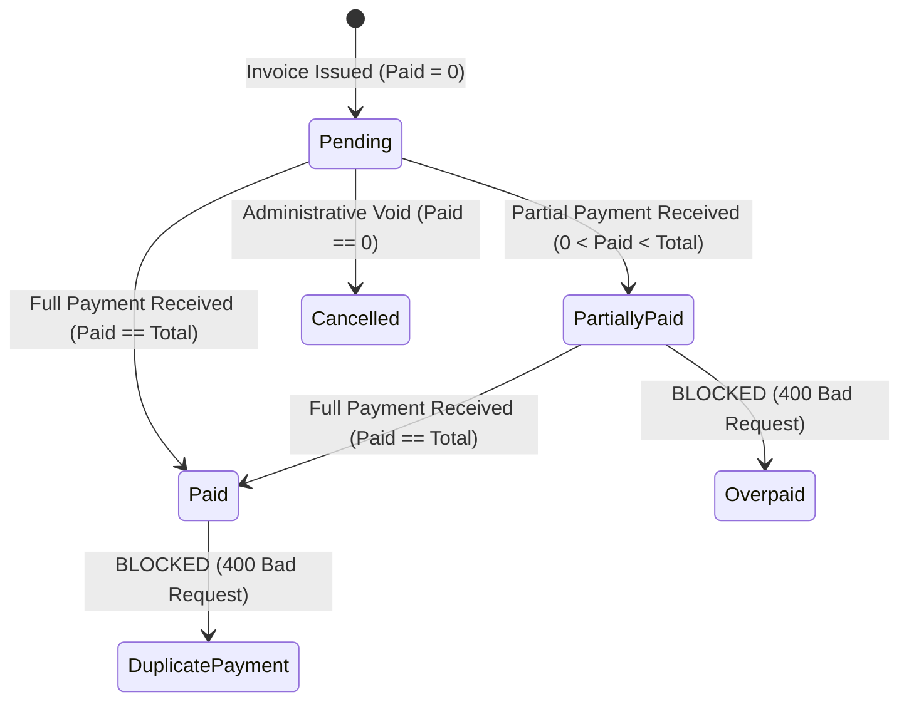

# TECHNICAL ARCHITECTURE REPORT
## School Management System (Algions AI Labs Assessment)
**Author**: Full-Stack Engineering Candidate  
**Date**: November 2026  
**Stack**: Node.js, Express.js (ES Modules), MongoDB, Mongoose, React 18, Vite, Zod, Jest, Supertest  

---

### Executive Summary
This document provides a comprehensive analysis of the architectural patterns, security controls, database indexing strategies, financial ledger design, and mathematical reconciliation rules implemented in the **School Management System**. The platform is constructed as a modular monolith adhering to separation of concerns across presentation, business logic, authorization, and data persistence layers.

---

## 1. Role-Based Access Control (RBAC) Architecture

### Design Philosophy
Access control is enforced **strictly at the server layer** through composable Express middlewares. Client-side interface conditioning (e.g. hiding navigation links or action buttons) is treated solely as a user experience convenience; no authorization guarantee relies on client-side state.

### Middleware Pipeline
1. **`authenticate`**:
   - Inspects the HTTP `Authorization: Bearer <token>` header or `token` cookie.
   - Decodes the cryptographically signed JWT using `ENV.JWT_SECRET`.
   - Validates that the subject user exists and remains active (`isActive: true`).
   - Attaches the verified user entity to `req.user`.

2. **`authorizeRoles(...allowedRoles)`**:
   - Verifies whether `req.user.role` exists within the permitted roles for the target route.
   - Emits a standardized `403 Forbidden` response upon role mismatch.

3. **Domain Ownership & Assignment Guards**:
   - **`authorizeTeacherAssignment`**:
     When an instructor attempts to query or mutate attendance (`/api/v1/attendance/*`) or enter examination marks (`/api/v1/exams/marks`), the middleware checks MongoDB for an active `TeacherAssignment` linking the instructor's profile to the target `Class`, `Section`, and `Subject`. Access to unassigned classes terminates with `403 Forbidden`.
   - **`authorizeGuardianStudent`**:
     When a parent or guardian requests student-specific data (attendance histories, report cards, or fee invoices), the middleware retrieves the `Guardian` record associated with `req.user._id` and verifies that the requested `studentId` exists in the guardian's `students` array. Unlinked requests return `403 Forbidden`.



---

## 2. Idempotency & Financial Transaction Integrity

### The Double-Charge Vulnerability
In web-based fee processing, high-latency networks or rapid user double-clicks frequently cause duplicate payment submissions. If unhandled, this results in double-debiting user funds, corrupted account balances, and negative invoice states.

### Idempotency Key Implementation
1. **Mandatory Idempotency Token**:
   Every payment submission (`POST /api/v1/fees/payments`) requires an `idempotencyKey` string in the request body (validated via Zod).
2. **Pre-Flight Lookup**:
   Prior to state mutation, the `FeeService.recordPayment` method executes:
   ```javascript
   const existingPayment = await Payment.findOne({ idempotencyKey });
   if (existingPayment) {
     const invoice = await Invoice.findById(existingPayment.invoice);
     return {
       isDuplicate: true,
       message: 'Payment already processed with this idempotency key (idempotent response)',
       payment: existingPayment,
       invoice,
     };
   }
   ```
3. **Database Uniqueness Guarantee**:
   The `Payment` schema enforces a unique index on `idempotencyKey`:
   ```javascript
   paymentSchema.index({ idempotencyKey: 1 }, { unique: true });
   ```
4. **Result**:
   Retried or duplicate requests return the original successful receipt and current invoice state with status `200 OK` rather than generating duplicate payments.

---

## 3. Financial Fee Ledger & Mathematical Reconciliation

### Ledger Data Model (`LedgerEntry`)
The system employs a double-entry ledger pattern where student liability is tracked via atomic debit and credit entries:
- **Debit (`debit > 0`)**: Increases the student's liability to the institution (e.g. Invoice issuance).
- **Credit (`credit > 0`)**: Decreases the student's liability (e.g. Payment receipt or fee waiver).
- **Running Balance (`runningBalance`)**: Stores the cumulative net balance at that point in time:
  $$\text{RunningBalance}_n = \text{RunningBalance}_{n-1} + \text{Debit}_n - \text{Credit}_n$$

### Invoice Status State Machine
Invoices transition strictly through valid states, validated at the business logic layer:



1. **Overpayment Protection**:
   If a proposed payment amount exceeds the invoice's remaining `outstandingAmount`, the transaction is rejected immediately with `400 Bad Request`.
2. **Terminal State Protection**:
   Payments on invoices already in `Paid` or `Cancelled` states are rejected with `400 Bad Request`.

### System-Wide Reconciliation Audit
The ledger service provides real-time verification that cumulative invoice totals, payment receipts, and ledger lines are in complete mathematical alignment:
$$\sum \text{Invoice.totalAmount} = \sum \text{LedgerEntry.debit}$$
$$\sum \text{Payment.amount} = \sum \text{LedgerEntry.credit}$$
$$\sum \text{Invoice.outstandingAmount} = \sum \text{LedgerEntry.debit} - \sum \text{LedgerEntry.credit}$$

---

## 4. Database Indexing Strategy

To guarantee sub-millisecond query performance and hardware-enforced integrity, the following indexes are declared in Mongoose:

| Collection | Indexed Fields | Type | Purpose |
| :--- | :--- | :--- | :--- |
| **`User`** | `{ email: 1 }` | Unique | Prevents duplicate user accounts across the system. |
| **`Student`** | `{ admissionNo: 1 }` | Unique | Enforces distinct institutional admission identifiers. |
| **`Student`** | `{ class: 1, section: 1, rollNumber: 1 }` | Compound | Fast classroom roster retrieval by roll number. |
| **`Attendance`** | `{ student: 1, date: 1, session: 1 }` | **Unique Compound** | Guarantees that a student cannot have duplicate attendance records for the same date and session (Morning/Afternoon). Supports safe upsert. |
| **`TeacherAssignment`**| `{ teacher: 1, class: 1, section: 1, subject: 1, academicYear: 1 }` | **Unique Compound** | Prevents conflicting duplicate teaching delegations. |
| **`ExamResult`** | `{ exam: 1, student: 1 }` | **Unique Compound** | Ensures one unified result record per student per exam. |
| **`Payment`** | `{ idempotencyKey: 1 }` | Unique | Hard constraint preventing duplicate financial transactions. |
| **`Payment`** | `{ invoice: 1, paidAt: -1 }` | Compound | Fast invoice payment history retrieval. |
| **`LedgerEntry`** | `{ student: 1, timestamp: 1 }` | Compound | Chronological ledger balance computation per student. |
| **`AuditLog`** | `{ entity: 1, action: 1, timestamp: -1 }` | Compound | High-performance forensic filtering on the admin trail. |

---

## 5. Dynamic Grading Engine

Rather than hardcoding academic grading criteria in application logic, the grading rules reside in MongoDB (`GradingRule` collection) and are editable by administrators.

### Evaluation Workflow
1. When a teacher or administrator enters subject marks (`POST /api/v1/exams/marks`), the system checks:
   $$\text{marksObtained} \le \text{maxMarks}$$
2. The active grading rules are retrieved sorted descending by `minPercentage`:
   ```javascript
   const sorted = [...rules].sort((a, b) => b.minPercentage - a.minPercentage);
   ```
3. Percentage for each course is computed:
   $$\text{Percentage} = \frac{\text{marksObtained}}{\text{maxMarks}} \times 100$$
4. Overall examination result calculates cumulative totals:
   $$\text{TotalPercentage} = \frac{\sum \text{MarksObtained}}{\sum \text{MaxMarks}} \times 100$$
5. Pass/Fail status requires passing all individual subjects and satisfying the minimum overall grade passing threshold (`isPassing: true`).

---

## 6. Immutable Audit Trail Architecture

All material events trigger an asynchronous write to the `AuditLog` collection:
- `actor`: MongoDB ObjectId referencing `User`
- `actorName`: Cached name for rapid display
- `role`: Role at execution time (`ADMIN`, `TEACHER`, `GUARDIAN`, `SYSTEM`)
- `action`: Standardized event string (`LOGIN`, `ATTENDANCE_MARK`, `MARKS_ENTRY`, `CREATE_INVOICE`, `PAYMENT_RECORD`, `ASSIGN_TEACHER`)
- `entity`: Model name (`User`, `Student`, `Attendance`, `ExamResult`, `Invoice`, `Payment`)
- `entityId`: Primary key of affected record
- `details`: JSON payload capturing changes
- `ipAddress` & `userAgent`: Client metadata
- `timestamp`: UTC date-time of event

---

## 7. Verification of Acceptance Tests

The test suite executes 19 automated tests validating the 5 core acceptance criteria:

| Acceptance Test Criterion | Implemented Test | Result |
| :--- | :--- | :--- |
| **(a) Teacher class isolation** | Attempted attendance submission for assigned class (200 OK) vs unassigned class (403 Forbidden). | **PASSED** |
| **(b) Duplicate attendance handling** | Consecutive attendance submissions for identical student, date, and session safely upserted without 11000 collision. | **PASSED** |
| **(c) Exam result calculation** | Evaluation of subject marks against DB grading rules verifies aggregate, percentage, letter grade, and pass/fail. Rejects marks > max. | **PASSED** |
| **(d) Guardian data isolation** | Guardian requesting report card of linked child (200 OK) vs unlinked student (403 Forbidden). | **PASSED** |
| **(e) Fee ledger reconciliation** | Invoice debits minus payment credits reconcile with running balance. Idempotent key deduplication, overpayment block, and invalid state block verified. | **PASSED** |

